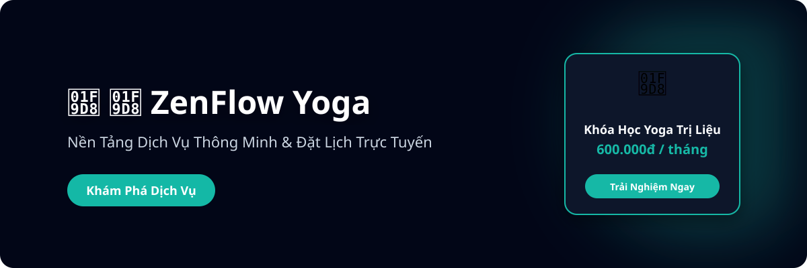

# 🧘 ZenFlow Yoga - Meditation & Wellness Studio

<p align="center">
  
</p>

Website Đặt lớp Học Yoga, Thiền chuông xoay Tây Tạng và Khóa tu chữa lành tâm hồn bằng Go

Một dự án Web Application trọn gói được **tự xây dựng từ con số 0 (build from scratch)** bao gồm cả Backend Go Server và Giao diện người dùng Web Responsive bằng HTML5 & Tailwind CSS.

---

## 🌟 Điểm Nổi Bật
* **Giao diện Trực quan:** Thiết kế hiện đại kèm ảnh đồ họa vector SVG sắc nét nhúng trực tiếp vào dự án.
* **Mã nguồn độc lập (Zero Dependencies):** Khởi chạy server web và phục vụ toàn bộ giao diện chỉ với 1 lệnh Go.
* **Sẵn sàng triển khai:** Dễ dàng đóng gói Docker hoặc mở rộng API REST.

---

## 🚀 Hướng Dẫn Chạy & Trải Nghiệm Giao Diện

### 1. Chạy Unit Test
```bash
go test -v ./...
```

### 2. Khởi chạy Web Server
```bash
go run main.go
```

Truy cập địa chỉ trong trình duyệt:  
👉 **http://localhost:8106**

---

## 📝 Bản Quyền & Tác Giả
Được xây dựng bởi [k3ndzy](https://github.com/k3ndzy). Phát hành theo giấy phép MIT.
